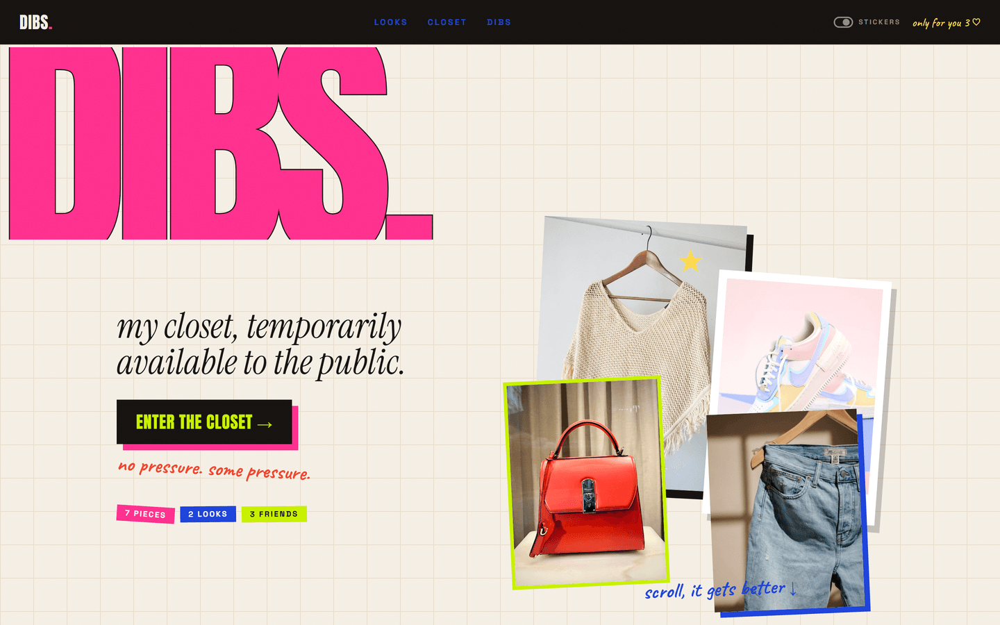
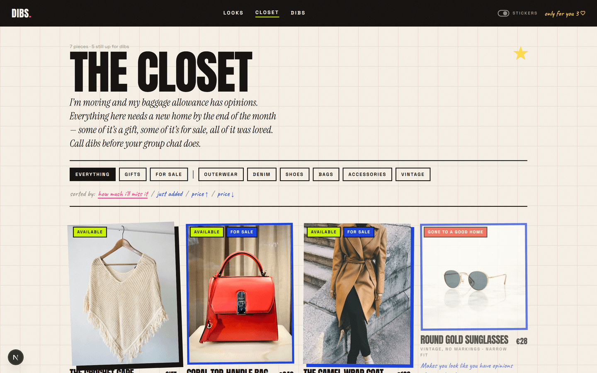
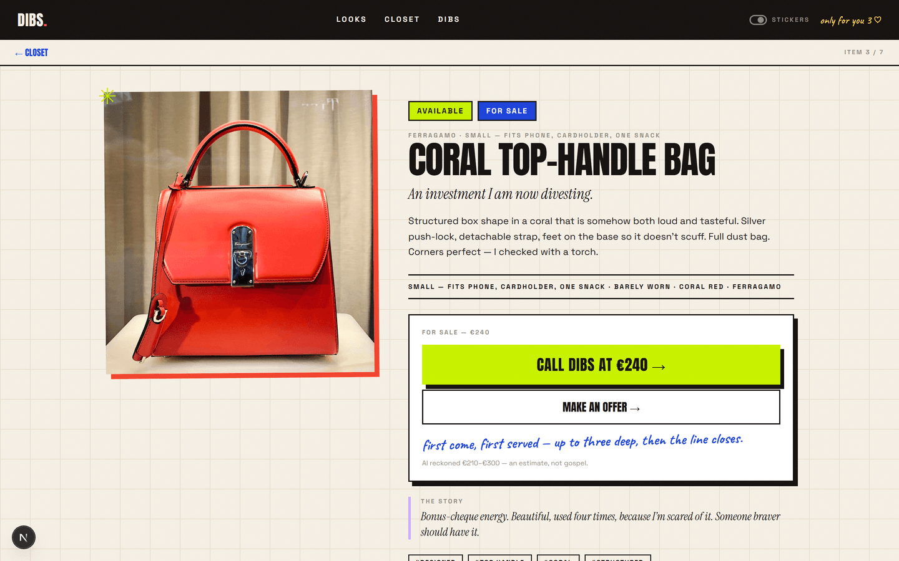
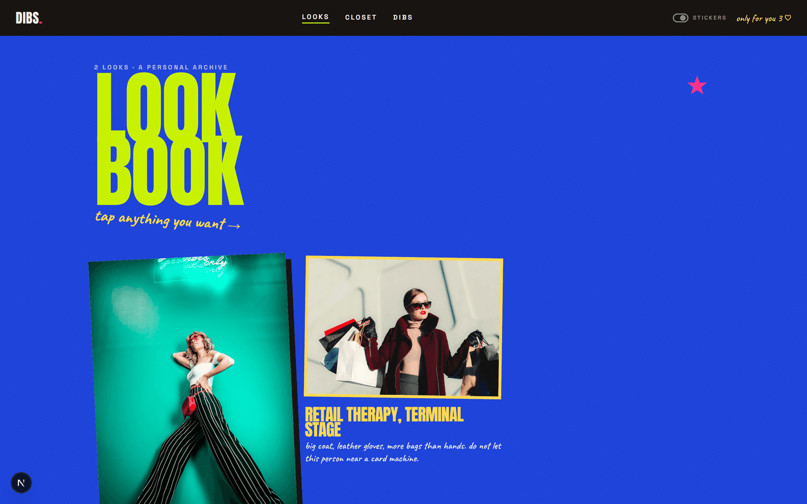

<div align="center">

# DIBS

**My closet, temporarily available to the public.**

A private, shareable digital closet. Friends open one link, browse the pieces
you're parting with, and **call dibs** — instead of forty messages in a group chat
and someone always missing out.

[**Live demo →**](https://dibs-beige.vercel.app)

[](https://nextjs.org)
[](https://react.dev)
[](https://www.typescriptlang.org)
[](https://tailwindcss.com)
[](LICENSE)

</div>

---

## The problem

You're moving in a week and have to shed most of a wardrobe. The default is a
chaotic group chat: photos scattered across the thread, *"is this still
available?"*, two people claiming the same jacket, and no record of who gets what.

## The product

One shareable link. Two lanes:

- **GIFT** — free pieces a friend claims with their name
- **SELL** — the designer bits, with a price and an offer flow

…and a **queue of three** on every piece. The first person holds it, two wait. If
someone ahead drops out — they pass, or the owner marks them as fallen through —
the next person is promoted automatically. That's the bit that actually solves the
coordination problem, not just the display problem.

No accounts. No app. No group chat.

---

## Screens

|  |  |
|---|---|
|  |  |
| **Landing** — the pitch, and a peek inside | **The closet** — filter gifts / for-sale / category |
|  |  |
| **A piece** — story, specs, and the dibs action | **Lookbook** — outfits that link back to pieces |

---

## Features

- **Collage gallery** — irregular masonry, every tile deterministically tilted
- **Call dibs** — a 3-deep queue per piece with automatic promotion
- **Offers** — counter-offers on for-sale pieces, accepted or declined by the owner
- **Lookbook** — outfit photography where each look links its pieces, so a friend
  can call dibs straight from a look
- **The dibs board** — who claimed what, and what's still on the table
- **Owner dashboard** — add/edit pieces and looks, manage every queue, accept offers
- **AI cataloguing** — upload a photo, get a drafted listing *in the owner's voice*
- **Mobile-first** — the collage recomposes into a clean single column, and
  rotations tame themselves via one CSS custom property

---

## Design system

The art direction was designed as a **7-screen board first**, then implemented as
spec. The brief was explicit: **"visual chaos, perfect UX."** Fashion scrapbook ×
digital moodboard × Gen-Z internet — deliberately *not* minimalist SaaS.

Three rules from the board are enforced in code, not just eyeballed:

> **Chrome stays black and fixed.**
> **State is always a coloured *label*, never a colour alone.**
> **Only decoration rotates — never text you must read.**

**Type** — Anton (display) · Instrument Serif (editorial voice) · Space Grotesk
(UI) · Caveat (margin notes)

**Palette** — hot pink `#FF2D8B` · acid `#C6F000` · cobalt `#1B3FD8` · tomato
`#F0402A` · cream `#F4EEE4` · ink `#14110F`

Collage is a component system — `Tape`, `Sticker`, `Stamp`, `Scrawl`, `PhotoFrame`,
`Doodle` — using **seeded** pseudo-randomness so rotations stay identical between
server render and hydration instead of jittering on every navigation. Decorative
stickers are a user toggle, and everything respects `prefers-reduced-motion`.

---

## Architecture

```
src/
├─ app/                  routes, server actions, API handlers
├─ components/
│  ├─ collage/           Tape · Sticker · Stamp · Scrawl · PhotoFrame · Doodle
│  ├─ dibs/              the claim / queue / offer panel
│  ├─ item/ · closet/    gallery + cards
│  ├─ admin/             owner dashboard editors
│  └─ site/              nav, footer
└─ lib/
   ├─ repo.ts            ← the only module that touches the store
   ├─ db/                store (file | Postgres), seed, normalise
   ├─ ai/                prompt + Anthropic vision call
   ├─ images.ts          HEIC decode → rotate → resize → JPEG
   └─ storage.ts         images (local disk | Vercel Blob)
```

**Three decisions worth naming:**

**A repository seam.** Every read and write goes through `lib/repo.ts`. Pages never
touch the database. Swapping a JSON file for Postgres was a one-file change — which
is why the store is *dual-mode* today: no env vars → local JSON file, `DATABASE_URL`
set → Postgres. Local development needs zero setup.

**Optimistic concurrency.** The closet is one JSON document behind a version column.
Writes are `UPDATE … WHERE version = $n` with retry, so two friends calling dibs from
different serverless instances can't clobber each other.

**Self-healing data.** Every read runs a normaliser that migrates older record shapes
forward — queues, slugs, statuses. When a bug once blanked an item's URL slug, the fix
shipped *and* repaired the live data on the next page load, with no migration script.

### The AI, honestly

Upload a garment photo and Claude drafts the name, category, colour, condition, tags,
alt text, a description in the owner's voice, and a suggested resale **range**. A human
then reviews and edits **every field** before publishing, and prices are always labelled
estimates, never valuations.

With no API key configured, the button says so plainly and you fill the form by hand.
**It never fabricates a result and presents it as the model's.**

---

## Stack

| | |
|---|---|
| Framework | Next.js 16 (App Router, Server Components, Server Actions) |
| Language | TypeScript, React 19 |
| Styling | Tailwind CSS v4 |
| Database | Neon Postgres (serverless) — or a local JSON file |
| Images | Vercel Blob · `sharp` · `heic-convert` |
| AI | Anthropic API (`@anthropic-ai/sdk`) — vision + structured tool use |
| Validation | `zod` on every server action |
| Motion | `motion` |
| Hosting | Vercel |

---

## Run it locally

```bash
git clone https://github.com/<you>/dibs.git
cd dibs
npm install
cp .env.example .env.local
npm run dev
```

Open <http://localhost:3000>. No database needed — the first run seeds a demo closet
from `data/initial.json` into `data/db.json`.

The owner dashboard is at `/admin` (password from `.env.local`).

### Environment

| Variable | Required | Purpose |
|---|---|---|
| `DIBS_ADMIN_PASSWORD` | yes | Guards `/admin` |
| `ANTHROPIC_API_KEY` | no | Enables AI cataloguing — without it the UI says so |
| `DATABASE_URL` | no | Switches the store to Postgres |
| `BLOB_READ_WRITE_TOKEN` | no | Switches image storage to Vercel Blob |

Deployment steps are in **[DEPLOY.md](DEPLOY.md)**.

---

## Notes

The demo imagery in `public/seed/` is placeholder photography from
[Unsplash](https://unsplash.com/license) — see
[`public/seed/CREDITS.md`](public/seed/CREDITS.md). Real uploads go to blob storage
and are not part of this repository.

Built with [Claude Code](https://claude.com/claude-code).

## Licence

[MIT](LICENSE)
